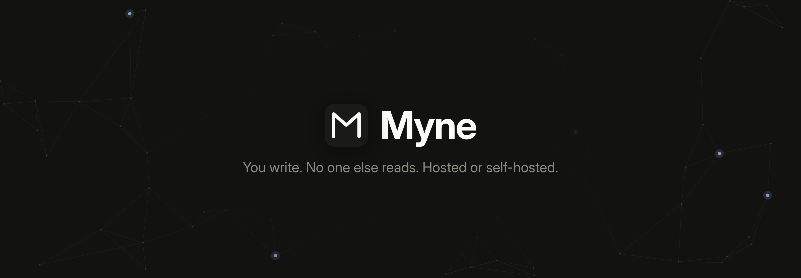

<p align="center"></p>

# Myne

> You write. No one else reads. Hosted or self-hosted.

This is the main repository of the [Myne](https://github.com/myne-md/myne) project — an end-to-end-encrypted, local-first markdown notes app with optional zero-knowledge sync. It holds three things: the Tauri 2 + Vite + React + TypeScript desktop client ([`src/`](src/), [`src-tauri/`](src-tauri/)), the Rust cryptographic protocol crate ([`protocol/`](protocol/)), and the canonical v0.1 specification, threat model, and decisions log ([`docs/`](docs/)). The browser-clipper native host and clip pipeline also live here ([`src-tauri/src/clipper/`](src-tauri/src/clipper), [`src/clip/`](src/clip)).

The companion repos (server, mobile, website, ops, agents, clipper extension, themes, branding assets, test vectors) live under the [`myne-md`](https://github.com/myne-md) organization and are described below. The specs in this repo's [`docs/`](docs/) are the source of truth across every client and implementation.

## What Myne commits to

- **End-to-end encrypted, no opt-out.** Note content, titles, folder structure, timestamps, and attachments stay encrypted at rest and in transit. There is no plaintext mode.
- **Plain markdown after decryption.** No proprietary block format. If Myne disappears, your files are already in the format every editor understands.
- **No email at signup, no email recovery.** A 20-character Crockford-base32 account number with a Damm-32 check character identifies you ([`docs/spec/account-number.md`](docs/spec/account-number.md)). Recovery is a BIP-39 24-word phrase. Lose both password and phrase and the data is unrecoverable — by design.
- **Argon2id (`m=256 MiB, t=3, p=2`)** for password stretching, with parameters bound into the AEAD AAD to defeat downgrade attacks.
- **XChaCha20-Poly1305 with a CTX commitment** for every AEAD operation, closing partitioning-oracle attacks.
- **Same protocol for hosted sync and self-host.** Both sit on the same trust boundary (TB5). Self-hosting changes the operator, not the security model.

The threat model is normative: marketing copy and code may not exceed its guarantees.

## Status

**Pre-alpha.** No release has shipped, the on-disk format is still pre-1.0, and v0.1 and the future v005 major are forward-incompatible by design. That said, the desktop client is well past scaffold stage. What concretely exists in this repo today:

- **Protocol crate ([`protocol/`](protocol/))** — `#![no_std]` + `alloc`, built on the RustCrypto stack with no custom primitives. Implements account numbers, KDF, AEAD, subkey derivation, BIP-39 recovery, and every blob family the magic-byte registry allocates — per-note, vault metadata, prefs, search, workspace, indices, attachments + catalog, backup container, personal dictionary, quick-unlock, attachment-text, sync baseline, AI embeddings, pending capture, graph layout, share import, custom themes ([`docs/spec/protocol.md`](docs/spec/protocol.md) §10.3 is the registry of record). Covered by a large unit, property-based, and attack test suite.
- **Desktop core ([`src-tauri/`](src-tauri/))** — Tauri 2 host with atomic writes, auto-lock, snapshot/backup, vault registry and migration, on-device search and spell-check, screen-capture protection, and the browser-clipper native-messaging host. Capability ACLs live under [`src-tauri/capabilities/`](src-tauri/capabilities).
- **UI ([`src/`](src/))** — React 19 vault onboarding/unlock/recovery flows, a CodeMirror 6 markdown editor (reading/source modes, folding, find-and-replace, multi-cursor, wikilinks, tags), graph view, attachments, saved views, and export (TXT/HTML/PDF).
- **Specs ([`docs/`](docs/))** — complete v0.1 protocol, threat model, account-number spec, canonical glossary, and an append-only decisions log.
- **Web client ([`web/`](web/))** — the Phase 3 desktop-**browser** target. Not a second UI: it compiles the same [`src/`](src/) tree and the same [`protocol/`](protocol/) crate (to `wasm32-unknown-unknown`), substituting one internal boundary — the platform seam at [`src/platform/`](src/platform/) — at build time. Deliberately narrower than the native clients: no quick-unlock, no backup import/export, no use of the recovery phrase as a device-enrolment credential, and it requires sync. Account creation and phrase-based recovery were out of scope until 2026-08-15 and now ship (`decisions.md` entry 0514). Its delivery channel is weaker than a signed desktop build; see [`docs/threat-model.md`](docs/threat-model.md) A15 / TB11 for exactly what that costs.
- **E2E suite ([`e2e/`](e2e/))** — 93 scenario files today (`e2e/*.e2e.ts`) driving the production binary via tauri-driver, plus the browser-driven web lane ([`e2e-web/`](e2e-web/)). A new user-facing flow ships with its E2E coverage.

Planned and not yet in this repo: a tagged release and signed reproducible builds. The published bundle-hash record the web client's verifiability story depends on **does** exist — [`docs/web-bundle-hashes.md`](docs/web-bundle-hashes.md), append-only and enforced by CI as a *precondition* of the deploy, so a bundle whose hash was not published first cannot reach the origin. A maintainer-run hosted instance is deployed from `develop` at [app.myne.md](https://app.myne.md). The sync **server** and the **mobile** client live in their own companion repos (below); the web client does not — it is the in-repo `web/` target above.

## Repository layout

```
myne/
├── docs/                ← specs, threat model, glossary, decisions log
├── src/                 ← React UI — shared by BOTH clients
│   ├── clip/            ← clip assembly + dispatch (clipper-paired)
│   └── platform/        ← platform seam: the only place allowed to import @tauri-apps/*
├── editor/              ← @myne/editor — shared CodeMirror engine, platform IO injected
├── dialect/             ← @myne/dialect — shared markdown-parser core
├── copy/                ← @myne/copy — load-bearing strings, byte-identical across clients
├── locales/             ← translation catalogs, one directory per language
├── src-tauri/           ← Tauri 2 + Rust desktop core
│   ├── capabilities/    ← Tauri capability ACLs (security-load-bearing)
│   └── src/clipper/     ← browser-clipper native-messaging host
├── core/                ← myne-core — shared Rust backend, desktop + mobile
├── protocol/            ← Rust cryptographic protocol crate (no_std + alloc)
├── theme-validator/     ← custom-theme allowlist, shared with the themes marketplace
├── web/                 ← Phase 3 desktop-browser client (same src/ tree, seam substituted)
├── e2e/                 ← tauri-driver end-to-end scenarios + fixture-gen (desktop lane)
├── e2e-web/             ← browser-driven web E2E lane (web-specific behaviour only)
├── tests/               ← Vitest unit/integration specs
├── scripts/             ← build helpers + the CI guards (platform seam, wasm, bundle record)
├── public/              ← static assets bundled into the WebView
├── workspace/           ← multi-repo helper scripts + manifest
├── Cargo.toml           ← Cargo workspace root; its members list is the crate roster
├── Cargo.lock           ← single shared lockfile (audit anchor)
├── rust-toolchain.toml  ← pinned Rust toolchain
└── package.json         ← pnpm + Vite + React + TS toolchain
```

The desktop client lives at the repo root, not under `apps/`, because mobile, server, and website each live in a dedicated companion repo — a one-child `apps/desktop/` would be needless nesting. The **web** client is the exception, and deliberately so: it lives in-repo at `web/` because it compiles the same `src/` tree, and a cross-repo split would mean publishing that tree as a versioned package — reintroducing exactly the drift the shared tree exists to prevent ([`docs/decisions.md`](docs/decisions.md), 2026-07-26). The Rust crates named in [`Cargo.toml`](Cargo.toml)'s `members` list — `src-tauri/`, `protocol/`, `core/`, `theme-validator/`, `e2e/fixture-gen/`, `web/wasm/` and `web/bench/wasm/` — are members of one Cargo workspace sharing a single root `Cargo.lock` so there is exactly one auditable lockfile.

## Development

Pinned toolchains: Node ([`.nvmrc`](.nvmrc)), Rust ([`rust-toolchain.toml`](rust-toolchain.toml)). `pnpm` is the canonical package manager; do not bypass the pinning.

```bash
pnpm install            # install JS toolchain
pnpm tauri dev          # full Tauri dev (Vite on :1420 + Rust core)
pnpm dev                # Vite only (strictPort — fails if 1420 is taken)
pnpm tauri build        # production desktop bundle

pnpm web:dev            # web client dev server on :1421 (runs alongside the desktop one)
pnpm web:build          # typecheck web/ against the shared src/ tree + production web bundle

pnpm test               # Vitest unit/integration suite
pnpm test:e2e           # tauri-driver end-to-end scenarios
cargo test -p protocol  # protocol crate tests
cargo clippy --workspace --all-targets -- -D warnings
```

Git hooks are managed by [lefthook](https://github.com/evilmartians/lefthook) ([`lefthook.yml`](lefthook.yml)) — one-time `brew install lefthook && lefthook install` per clone. `pre-commit` runs the fast lint set; `pre-push` runs the full battery (clippy, `cargo test`, `pnpm build`). CI is the remote gate.

Read [`docs/`](docs/) before changing anything that touches cryptography, the on-disk format, key handling, or sync. Start with [`docs/threat-model.md`](docs/threat-model.md), then [`docs/spec/protocol.md`](docs/spec/protocol.md).

## Companion repositories

The full project spans several repos under the [`myne-md`](https://github.com/myne-md) organization. Clone the companions into this directory via [`workspace/setup.sh`](workspace/setup.sh) (the main repo's `.gitignore` excludes them so they do not show as untracked).

| Repo | What it is |
|---|---|
| [`myne-server`](https://github.com/myne-md/myne-server) | Zero-knowledge sync server — the TB5 trust boundary, identical hosted and self-hosted |
| [`myne-clipper`](https://github.com/myne-md/myne-clipper) | Browser-extension clipper — the paired channel that talks to this repo's native host |
| [`myne-website`](https://github.com/myne-md/myne-website) | Marketing site (myne.md) |
| [`myne-test-vectors`](https://github.com/myne-md/myne-test-vectors) | Language-agnostic vectors that pin byte-level cross-implementation agreement on the protocol |
| [`myne-themes`](https://github.com/myne-md/myne-themes) | Community theme marketplace — validated design-token palettes, distribution side |
| [`myne-branding`](https://github.com/myne-md/myne-branding) | Brand assets — logo, wordmark, app-icon exports, color/type exports, fonts, press imagery |
| [`myne-ops`](https://github.com/myne-md/myne-ops) | Internal operations and infrastructure |
| [`myne-agents`](https://github.com/myne-md/myne-agents) | Internal tooling and agent definitions |

Each companion is a separate GitHub repo with its own license and CLAUDE.md — never commit changes to them through this repo.

## Security

Cryptography questions and vulnerability reports: see [`SECURITY.md`](SECURITY.md). The threat model ([`docs/threat-model.md`](docs/threat-model.md)) is the canonical record of adversaries, assets, trust boundaries, and limitations.

## License

This repository is multi-licensed by subtree (see [`LICENSING.md`](LICENSING.md) for the authoritative map):

- **Application code** — the desktop client (`src/`, `src-tauri/`) and the [`protocol/`](protocol/) crate — is **AGPL-3.0**, as declared in the crate manifests and per-file SPDX headers. The repo-root [`LICENSE`](LICENSE) carries the AGPL-3.0 text.
- **Specifications** — the [`docs/`](docs/) subtree — are **CC-BY-4.0** ([`docs/LICENSE`](docs/LICENSE)), so the protocol stays reusable for independent implementations as long as Myne is credited.

The licensing decision is recorded in [`docs/decisions.md`](docs/decisions.md).
