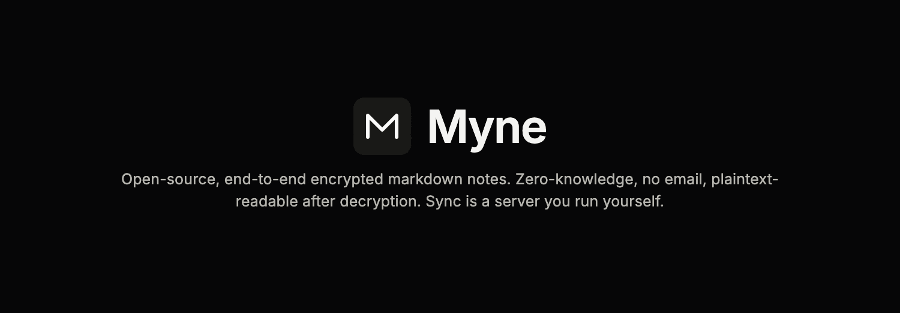

<p align="center"></p>

# Myne

> You write. No one else reads. Sync is a server you run.

This is the main repository of the [Myne](https://github.com/myne-md/myne) project: an end-to-end-encrypted, local-first markdown notes app with optional zero-knowledge sync. **All three clients live here**: the Tauri 2 desktop client ([`src/`](src/), [`src-tauri/`](src-tauri/)), the desktop-browser client ([`web/`](web/), the same [`src/`](src/) tree with the platform seam substituted at build time), and the iOS and Android client ([`mobile/`](mobile/)). The repository also holds the Rust cryptographic protocol crate ([`protocol/`](protocol/)), the shared Rust backend both native clients build on ([`core/`](core/)), the app-independent decrypter ([`decrypt/`](decrypt/)), the terminal client ([`cli/`](cli/)), the canonical specification, threat model, and decisions log ([`docs/`](docs/)), and the browser-clipper native host ([`src-tauri/src/clipper/`](src-tauri/src/clipper)).

The companion repos (server, website, ops, agents, clipper extension, themes, branding assets, test vectors, and the adversarial test range) live under the [`myne-md`](https://github.com/myne-md) organization and are described below. The specs in this repo's [`docs/`](docs/) are the source of truth across every client and implementation.

## What Myne commits to

- **End-to-end encrypted, no opt-out.** Note content, titles, folder structure, timestamps, and attachments stay encrypted at rest and in transit. There is no plaintext mode for your vault. (The plain-file editor opens a user's own separate on-disk `.md` files outside the vault; `design-notes/clients/0625`.)
- **Plain markdown after decryption.** No proprietary block format. If Myne disappears, your files are already in the format every editor understands.
- **No email at signup, no email recovery.** A 20-character Crockford-base32 account number with a Damm-32 check character identifies you ([`docs/spec/account-number.md`](docs/spec/account-number.md)). Recovery is a BIP-39 24-word phrase. Lose both password and phrase and the data is unrecoverable, by design.
- **Argon2id (`m=256 MiB, t=3, p=2`)** for password stretching, with parameters bound into the AEAD AAD to defeat downgrade attacks.
- **XChaCha20-Poly1305 with a CTX commitment** for every AEAD operation, closing partitioning-oracle attacks.
- **Same protocol whether you run the server or somebody else does.** An operator and a self-hoster sit on the same trust boundary (TB5): self-hosting changes the operator, not the security model. **Myne operates no sync service it offers**, so the client asks you for a server address and names none itself (`design-notes/sync/0696`).

The threat model is normative: marketing copy and code may not exceed its guarantees.

## Status

**Pre-alpha.** The on-disk format is still pre-1.0, and v0.1 and the next major are forward-incompatible by design. Tagged releases exist, `v0.1.0` through `v0.10.0`, published at [downloads.myne.md](https://downloads.myne.md). All three clients are well past scaffold stage. What concretely exists in this repo today:

- **Protocol crate ([`protocol/`](protocol/))**: `#![no_std]` + `alloc`, built on the RustCrypto stack with no custom primitives. Implements account numbers, KDF, AEAD, subkey derivation, BIP-39 recovery, and every blob family the magic-byte registry allocates ([`docs/spec/protocol.md`](docs/spec/protocol.md) §10.3 is the registry of record, and it is the only place the roster is listed). Covered by a large unit, property-based, and attack test suite.
- **Desktop core ([`src-tauri/`](src-tauri/))**: Tauri 2 host with atomic writes, auto-lock, snapshot/backup, vault registry and migration, on-device search and spell-check, screen-capture protection, and the browser-clipper native-messaging host. Capability ACLs live under [`src-tauri/capabilities/`](src-tauri/capabilities).
- **UI ([`src/`](src/))**: React 19, one tree shared by all three clients. Vault onboarding/unlock/recovery flows, a CodeMirror 6 markdown editor (reading/source modes, folding, find-and-replace, multi-cursor, wikilinks, tags), graph view, attachments, saved views, export (TXT/HTML/PDF), and a plain-file editor that opens a user's own on-disk `.md` outside the vault.
- **Specs ([`docs/`](docs/))**: complete v0.1 protocol, threat model, account-number spec, canonical glossary, and an append-only decisions log.
- **Web client ([`web/`](web/))**: the Phase 3 desktop-**browser** target. Not a second UI: it compiles the same [`src/`](src/) tree and the same [`protocol/`](protocol/) crate (to `wasm32-unknown-unknown`), substituting one internal boundary (the platform seam at [`src/platform/`](src/platform/)) at build time. Deliberately narrower than the native clients: no quick-unlock, no backup import/export, no use of the recovery phrase as a device-enrolment credential, and it requires sync. Account creation and phrase-based recovery were out of scope until 2026-08-15 and now ship (`decisions.md` entry 0514). Its delivery channel is weaker than a desktop build you download once and keep; see [`docs/threat-model.md`](docs/threat-model.md) A15 / TB11 for exactly what that costs. (Not weaker than a *signed* one, which this line said until 2026-08-25: no desktop artifact carries a signature any OS checks. The difference is persistence, not verification.)
- **Mobile client ([`mobile/`](mobile/))**: the iOS and Android target. Built on the same [`protocol/`](protocol/) and [`core/`](core/) crates, with its own React tree under `mobile/src` that source-consumes roughly twenty-five `@myne/*` aliases from [`src/`](src/). Wired: vault lifecycle, notes and attachments, search, backlinks, graph, foreground sync, quick unlock, screen-capture protection, voice notes, widgets and deep links. Its gaps are stated in [`mobile/README.md`](mobile/README.md) rather than left to be discovered.
- **E2E suite ([`e2e/`](e2e/))**: scenario files (`e2e/*.e2e.ts`) driving the production binary via tauri-driver, plus the browser-driven web lane ([`e2e-web/`](e2e-web/)) and the mobile flow-logic tier. The number of scenarios that must actually execute is a recorded ratchet in [`scripts/e2e-scenario-floor.json`](scripts/e2e-scenario-floor.json), not a figure restated here. A new user-facing flow ships with its E2E coverage.

Planned and not yet here: signed, reproducible desktop builds. The bundle-hash record the web client's verifiability story depends on **does** exist: [`docs/web-bundle-hashes.md`](docs/web-bundle-hashes.md), append-only, so a bundle whose hash was not recorded first should not reach the origin. Two qualifiers: the record is **not public** while this repository is not, so the third party it exists for cannot read it; and the `--has` precondition is enforced **by hand** in the deploy runbook rather than by CI, since the deploy left CI in myne-md/myne#584. **The maintainer-run web instance at `app.example.com` is closing** (2026-10-16): the web client ships as a container you serve yourself (`pnpm web:build`, `web/container/`), and Myne offers no hosted client. The sync **server** lives in its own companion repo (below); the web and mobile clients do not: they are the in-repo `web/` and `mobile/` targets above.

## Repository layout

```
myne/
├── docs/                ← specs, threat model, glossary, decisions log
├── src/                 ← React UI — one tree shared by all three clients
│   ├── clip/            ← clip assembly + dispatch (clipper-paired)
│   └── platform/        ← platform seam: the only place allowed to import @tauri-apps/*
├── editor/              ← @myne/editor — shared CodeMirror engine, platform IO injected
├── dialect/             ← @myne/dialect — shared markdown-parser core
├── copy/                ← @myne/copy — load-bearing strings, byte-identical across clients
├── client-core/         ← @myne/client-core — the cross-client decision layer (touches no host)
├── ornaments/           ← @myne/ornaments — the ornament layer a custom theme resolves against
├── preview/             ← @myne/preview — the captured theme-preview snapshot
├── locales/             ← translation catalogs, one directory per language
├── src-tauri/           ← Tauri 2 + Rust desktop core
│   ├── capabilities/    ← Tauri capability ACLs (security-load-bearing)
│   └── src/clipper/     ← browser-clipper native-messaging host
├── core/                ← myne-core — shared Rust backend plugin cores + host seams
├── protocol/            ← Rust cryptographic protocol crate (no_std + alloc)
├── format/              ← myne-format — the on-disk-format read path and the export walk
├── decrypt/             ← myne-decrypt — app-independent decrypter CLI
├── cli/                 ← myne-cli — the `myne` terminal client, a sidecar to the desktop
├── tor-sidecar/         ← arti as a loopback SOCKS5 proxy, a second sidecar
├── theme-validator/     ← custom-theme value allowlist, shared with the themes marketplace
├── web/                 ← desktop-browser client (same src/ tree, seam substituted)
├── mobile/              ← iOS and Android client (own React tree + Tauri crate)
├── stories/             ← the dev-only design-system workbench over src/
├── e2e/                 ← tauri-driver end-to-end scenarios + fixture-gen (desktop lane)
├── e2e-web/             ← browser-driven web E2E lane (web-specific behaviour only)
├── tests/               ← Vitest unit/integration specs
├── scripts/             ← build helpers + the repo guards
├── public/              ← static assets bundled into the WebView
├── workspace/           ← multi-repo helper scripts + manifest
├── Cargo.toml           ← Cargo workspace root; its members list is the crate roster
├── Cargo.lock           ← single shared lockfile (audit anchor)
├── rust-toolchain.toml  ← pinned Rust toolchain
└── package.json         ← pnpm + Vite + React + TS toolchain
```

The desktop client lives at the repo root rather than under `apps/`. A one-child `apps/desktop/` would be needless nesting. The **web** and **mobile** clients live in-repo too (`web/`, `mobile/`), and for the same reason recorded in [`design-notes.md`](design-notes.md) (2026-07-26 for web, 2026-08-13 for mobile): each compiles the same `src/` tree, and a cross-repo split would mean publishing that tree as a versioned package, reintroducing exactly the drift the shared tree exists to prevent. The Rust crates named in [`Cargo.toml`](Cargo.toml)'s `members` list (the desktop core, `protocol/`, `core/`, `format/`, `decrypt/`, `cli/`, `tor-sidecar/`, the mobile crate and its plugins, and the wasm entry crates among them) are members of one Cargo workspace sharing a single root `Cargo.lock` so there is exactly one auditable lockfile. `Cargo.toml`'s `members` list is the roster of record.

### Why the repository root is file-heavy

Almost every file at the root is there because a tool looks for it **by name**, not because nobody tidied up. Moving one is a silent breakage, so the list is deliberate — and it is worth reading before proposing a reorganisation:

| Root file(s) | Why it cannot move |
| --- | --- |
| `Cargo.toml`, `Cargo.lock`, `rust-toolchain.toml`, `deny.toml` | the Cargo workspace root, the single auditable lockfile ([`LICENSING.md`](LICENSING.md)), and the two files `cargo` and `cargo-deny` discover at the workspace root |
| `package.json`, `pnpm-lock.yaml`, `pnpm-workspace.yaml` | the pnpm workspace root; `pnpm` resolves its members from here |
| `index.html`, `pdf-export.html`, `vite.config.ts`, `vitest.config.ts`, `tsconfig.json`, `tsconfig.node.json` | Vite's root is the current directory, so its HTML entry points must sit here; `vitest.config.ts` is discovered by name, which is what every bare `vitest run` in this tree depends on |
| `tsconfig.tests.json` | the typecheck for the trees the shipped-code `tsconfig.json` deliberately excludes (`tests/`, `e2e/`, `e2e-web/`) |
| `lefthook.yml`, `opencode.json`, `i18next.config.js` | git-hook, agent-harness and i18n-extractor configuration, each discovered by filename |
| `flake.nix`, `flake.lock` | the Nix devshell; `nix develop` reads a flake from the repository root |
| `README.md`, `LICENSE`, `LICENSING.md`, `SECURITY.md`, `AGENTS.md` | the files GitHub and contributor tooling render or look for at a root |
| `PRODUCT.md`, `DESIGN.md`, `DESIGN.json` | the strategy and the visual system, read from the root by the design workflow and projected against [`docs/design/`](docs/design/) |
| `.config/` | tool configuration that has **no** name-discovery constraint, which is why it is the one directory holding it: `nextest.toml` for `cargo-nextest`, and `vitest/` for the five test lanes that are not the default one |

## Development

Pinned toolchains: Node ([`.nvmrc`](.nvmrc)), Rust ([`rust-toolchain.toml`](rust-toolchain.toml)). `pnpm` is the canonical package manager; do not bypass the pinning.

```bash
pnpm install            # install JS toolchain
pnpm tauri dev          # full Tauri dev (Vite on :1420 + Rust core)
pnpm dev                # Vite only (strictPort — fails if 1420 is taken)
pnpm tauri build        # production desktop bundle
pnpm sidecar            # build + stage all three externalBin sidecars (myne CLI, myne-mcp, myne-tor)

pnpm web:local          # web client on :1421 + a local sync server, in one command
pnpm web:dev            # web client dev server on :1421 (runs alongside the desktop one)
pnpm web:build          # typecheck web/ against the shared src/ tree + production web bundle

pnpm mobile:dev         # mobile client dev server on :1422 (all three can run at once)
pnpm mobile:build       # typecheck mobile/ + production mobile bundle
pnpm mobile:test        # mobile Vitest suite

pnpm test               # Vitest unit/integration suite
pnpm test:e2e           # tauri-driver end-to-end scenarios
pnpm test:e2e:web       # browser-driven web E2E lane
cargo test -p protocol  # protocol crate tests
cargo clippy --workspace --all-targets -- -D warnings
```

Git hooks are managed by [lefthook](https://github.com/evilmartians/lefthook) ([`lefthook.yml`](lefthook.yml)). Setup is a one-time `brew install lefthook && lefthook install` per clone. `pre-commit` runs the fast lint set; `pre-push` runs the full battery (clippy, `cargo test`, `pnpm build`). CI is the remote gate.

Read [`docs/`](docs/) before changing anything that touches cryptography, the on-disk format, key handling, or sync. Start with [`docs/threat-model.md`](docs/threat-model.md), then [`docs/spec/protocol.md`](docs/spec/protocol.md).

## Companion repositories

The full project spans several repos under the [`myne-md`](https://github.com/myne-md) organization. Clone the companions into this directory via [`workspace/setup.sh`](workspace/setup.sh) (the main repo's `.gitignore` excludes them so they do not show as untracked). [`workspace/manifest.txt`](workspace/manifest.txt) is the list `setup.sh` reads, and it does not carry `internal-service` or `homebrew-tap`, which are cloned by hand.

| Repo | What it is |
|---|---|
| [`myne-server`](https://github.com/myne-md/myne-server) | Zero-knowledge sync server: the TB5 trust boundary, identical hosted and self-hosted |
| [`myne-clipper`](https://github.com/myne-md/myne-clipper) | Browser-extension clipper: the paired channel that talks to this repo's native host |
| [`myne-website`](https://github.com/myne-md/myne-website) | Marketing site (myne.md) |
| [`myne-test-vectors`](https://github.com/myne-md/myne-test-vectors) | Language-agnostic vectors that pin byte-level cross-implementation agreement on the protocol |
| [`myne-themes`](https://github.com/myne-md/myne-themes) | Community theme marketplace: validated design-token palettes, distribution side |
| [`myne-branding`](https://github.com/myne-md/myne-branding) | Brand assets: logo, wordmark, app-icon exports, color/type exports, fonts, press imagery |
| [`operations`](https://github.com/example-org/operations) | Internal operations and infrastructure: Caddy edges, runbooks, the self-host bundle, release signing |
| [`agent-tooling`](https://github.com/example-org/agent-tooling) | Internal tooling and agent definitions: skills, subagents, and the planning trail they produce |
| [`internal-service`](https://github.com/example-org/internal-service) | Adversarial test range: attacks real released Myne builds against a malicious sync server, the network, at-rest storage, and the clients' own surface |
| [`homebrew-tap`](https://github.com/myne-md/homebrew-tap) | Homebrew tap for the macOS build |

Each companion is a separate GitHub repo with its own license and its own agent instructions. Never commit changes to them through this repo. The old `myne-web` companion is archived, and the old `myne-mobile` companion was deleted outright on 2026-08-13; both clients live in-repo now, at `web/` and `mobile/`.

## Security

Cryptography questions and vulnerability reports: see [`SECURITY.md`](SECURITY.md). The threat model ([`docs/threat-model.md`](docs/threat-model.md)) is the canonical record of adversaries, assets, trust boundaries, and limitations.

## License

This repository is multi-licensed by subtree (see [`LICENSING.md`](LICENSING.md) for the authoritative map):

- **Application code** is **AGPL-3.0** (not "or-later"): the shared UI (`src/`), the desktop core (`src-tauri/`), the web client (`web/`), the mobile client (`mobile/`), the shared backend (`core/`), and the [`protocol/`](protocol/) crate, as declared in the crate manifests and per-file SPDX headers. The repo-root [`LICENSE`](LICENSE) carries the AGPL-3.0 text.
- **Specifications** are **CC-BY-4.0**: the [`docs/`](docs/) subtree ([`docs/LICENSE`](docs/LICENSE)), so the protocol stays reusable for independent implementations as long as Myne is credited.

The licensing decision is recorded in [`design-notes.md`](design-notes.md).
