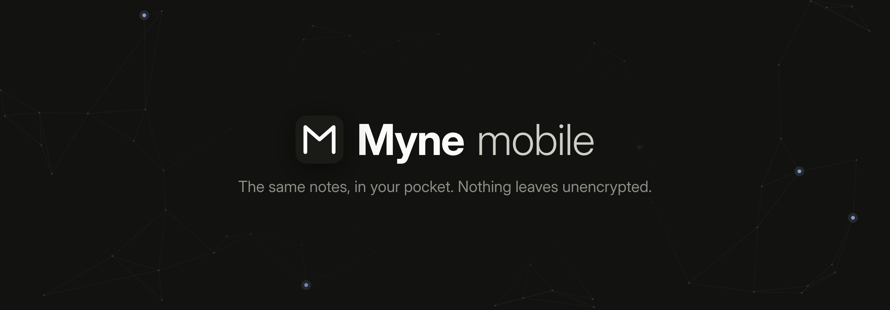

<p align="center"></p>

# Myne mobile

> The same notes, in your pocket. Nothing leaves unencrypted.

The mobile client for [Myne](https://github.com/myne-md/myne) — an open-source, end-to-end-encrypted, local-first markdown notes app with optional zero-knowledge sync. No email at signup: a 20-character account number identifies you, and a BIP-39 24-word phrase is your only recovery path. Keys are derived with Argon2id; notes are sealed with XChaCha20-Poly1305.

This repository is one of several under [`myne-md`](https://github.com/myne-md): the main repo ([`myne`](https://github.com/myne-md/myne)) holds the desktop client and the canonical specs, with companion repos for the sync server, web client, website, ops, and cross-implementation test vectors. The protocol, threat model, and on-disk format are defined once in the main repo's [`docs/`](https://github.com/myne-md/myne/tree/develop/docs) and shared by every client — read those before touching anything cryptographic here.

## Status

**Pre-alpha — Phase 3, not yet started.** Mobile is the last of the planned phases: the desktop client (Phase 1) ships first, the sync server (Phase 2) follows, and the mobile client lands in Phase 3 alongside the web client.

What exists in this repo today:

- `CLAUDE.md` — stack-direction notes, trade-off analysis, and architectural commitments carried over from the main project.
- `lefthook.yml` — baseline pre-commit hooks (whitespace check, EOF-newline check, secret-pattern guard).
- `LICENSE` — AGPL-3.0.

There is no application code yet — no source tree, no build configuration, no packaging. Everything below describes the intended direction, not a working client.

## Intended direction

The goal is maximum reuse of the audited main-repo codebase rather than a second, separately-audited implementation:

- **One crypto crate, every platform.** The main repo's `protocol/` Rust crate is `#![no_std]` + `alloc` precisely so it compiles for desktop, mobile, and (eventually) the web. No second crypto codebase to audit; primitives stay bit-identical by construction. `myne-test-vectors` validates those primitives, and a vector failure stops the world for all clients because they share the crate.
- **One UI codebase.** The main repo's React screens are meant to carry over, with per-platform differences kept to layout/CSS rather than a parallel UI.
- **One trust-boundary discipline.** The capability-ACL model used on desktop extends to mobile, scoped per platform (iOS and Android entitlements differ).

The concrete framework choice (Tauri 2 Mobile vs. the React Native direction recorded in the main repo's earlier plan) is not yet final — it is to be re-verified and recorded in the main repo's `docs/decisions.md` before Phase 3 work begins. See `CLAUDE.md` for the current reasoning and the open trade-offs.

Open questions that mobile must answer before it ships, all already flagged in the threat model and decisions log:

- **Argon2id on mobile.** The desktop parameters (`m=256 MiB, t=3, p=2`) may exceed mobile background-task budgets; a calibrated lower-cost unlock profile needs verification on real devices.
- **OS keychain integration** differs across iOS and Android.
- **Biometric vault unlock** is a UX win but a threat-model trade-off — it gets a `decisions.md` entry analyzing the cost before it ships, never by default.

Feature parity with desktop is explicitly **not** a launch goal: the first target is the minimum viable read-plus-write client (vault unlock, note read, note edit, sync). Parity creeps closer over time as code reuse pays off.

## Hard commitments

These hold for every Myne client and are not negotiable on mobile:

- No email at signup, no email recovery.
- No plaintext mode, no encryption opt-in — privacy is the default.
- No telemetry or analytics. App Store and Play Store ecosystems push analytics SDKs hard; the answer is to resist them, or document an explicit exemption in the main repo's `docs/decisions.md`.
- Reproducible builds — harder on mobile (Xcode/Gradle variability), still the goal; the recipe will live in `myne-ops`.

## Dev setup

There is no app to build yet. The only local tooling is the commit-hook baseline:

```bash
brew install lefthook && lefthook install   # one-time per clone; activates git hooks
```

Skip a hook run ad hoc with `LEFTHOOK=0 git commit …` or `git commit --no-verify`, only when you understand why.

## License

This repository is licensed **AGPL-3.0** (see [`LICENSE`](LICENSE)), matching the application code across the Myne project. The specifications in the main repo's `docs/` carry a permissive content license (CC-BY-4.0) so the protocol stays reusable by independent implementations.
