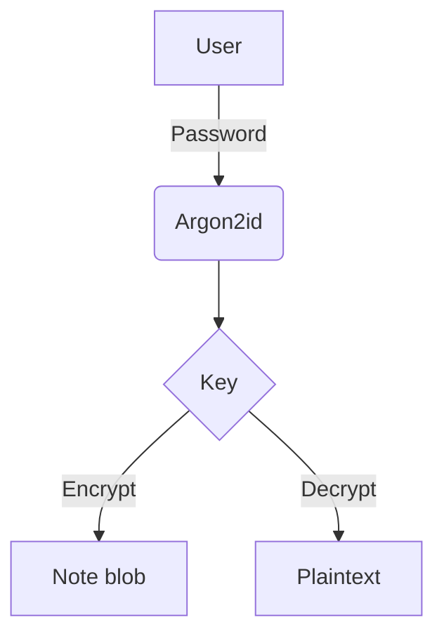
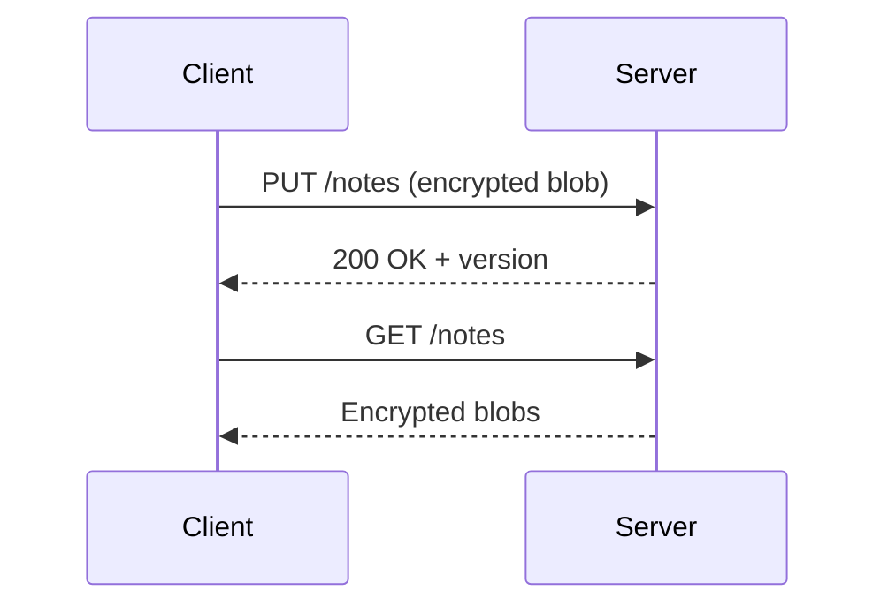
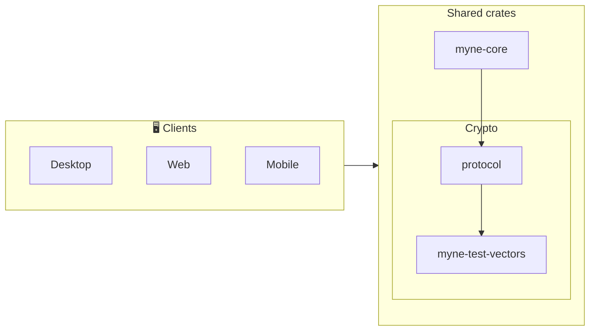

# H1 — First Level Heading

## H2 — Second Level Heading

### H3 — Third Level Heading

#### H4 — Fourth Level Heading

##### H5 — Fifth Level Heading

###### H6 — Sixth Level Heading

Alternative H1 Syntax
=====================

Alternative H2 Syntax
---------------------

---

## Paragraphs and Line Breaks

This is a regular paragraph. It contains a mix of characters including accents (é, ñ, ü, ø, æ).
This line is a continuation of the previous one ended with two trailing spaces — should produce a `<br>`.

This is the second paragraph. Paragraphs are separated by a blank line.

Two  
trailing  
spaces  
force  
line breaks.

---

## Inline Text Emphasis

- **Bold (asterisks)** and __bold (underscores)__
- *Italic (asterisks)* and _italic (underscores)_
- ***Bold italic*** and ___bold italic (underscores)___
- ~~Strikethrough~~ text
- ==Highlighted== text — supported by some dialects
- H~2~O — subscript
- X^2^ — superscript
- `inline code` for small code fragments
- Mixed: **bold with _italic_** and *italic with `code`*

Escape characters: \*asterisk\*, \_underscore\_, \`backtick\`, \\ backslash.

---

## Links

[Descriptive link text](https://myne.md)

[Link with title](https://myne.md "Myne home page")

Autolink: <https://myne.md>

Email: <hello@myne.md>

Bare URL: https://github.com/myne-md/myne

[Reference-style link][myne-ref]

[Short reference][myne-ref]

[myne-ref]: https://myne.md "Reference link definition"

[Numeric reference][1]

[1]: https://example.com

---

## Images


Reference-style image: ![Logo][logo-ref]

[logo-ref]: https://placehold.co/200x200 "Logo title"

Image wrapped in a link: [](https://myne.md)

---

## Lists

### Unordered List

- First item
- Second item
  - Nested item (2-space indent)
  - Second nested item
    - Third-level nested
- Third item

Alternative markers:

* Asterisk marker
+ Plus marker
- Hyphen marker

### Ordered List

1. First item
2. Second item
3. Third item
   1. Nested ordered item
   2. Second nested
      1. Three levels deep
4. Fourth item

Numbering does not have to be sequential:

1. First
1. Second (auto-renumbered to 2)
1. Third (auto-renumbered to 3)

### Mixed Nested List

1. Outer ordered item
   - Inner unordered item
   - Second inner item
     1. Back to ordered
     2. Second ordered
2. Second outer ordered

### Task List

- [x] Completed task
- [ ] Open task
- [x] ~~Completed and struck-through~~
- [ ] **Emphasized open task**
  - [x] Nested completed
  - [ ] Nested open

---

## Blockquotes

> A simple blockquote.

> Multi-line blockquote.
> The block continues on the next line.
>
> An empty `>` separates paragraphs.

> Nested blockquotes:
>> Second level
>>> Third level

> Blockquote with **formatting**, `code`, and a [link](https://myne.md):
>
> - Lists
> - can live here too.
>
> ```js
> // Even a fenced code block
> console.log("code inside a blockquote");
> ```

---

## Code Blocks

### Indented (4 spaces)

    function hello() {
      return "Hello, world";
    }

### Triple backticks (no language)

```
This is a plain fenced code block.
No syntax highlighting.
```

### JavaScript

```javascript
// JavaScript example
const myne = {
  name: "Myne",
  version: "0.1",
  encrypt: async (note) => {
    const key = await deriveKey(password);
    return aead.seal(key, note);
  }
};

console.log(`Encrypted: ${myne.name}`);
```

### TypeScript

```typescript
interface Note {
  id: string;
  title: string;
  content: string;
  createdAt: Date;
  tags?: string[];
}

function createNote(title: string, content: string): Note {
  return {
    id: crypto.randomUUID(),
    title,
    content,
    createdAt: new Date(),
  };
}
```

### Rust

```rust
use std::collections::HashMap;

#[derive(Debug, Clone)]
pub struct Note {
    pub id: String,
    pub title: String,
    pub encrypted_body: Vec<u8>,
}

impl Note {
    pub fn new(title: &str) -> Self {
        Self {
            id: uuid::Uuid::new_v4().to_string(),
            title: title.to_string(),
            encrypted_body: Vec::new(),
        }
    }
}
```

### Python

```python
def fibonacci(n: int) -> list[int]:
    """Return the Fibonacci sequence."""
    seq = [0, 1]
    for _ in range(n - 2):
        seq.append(seq[-1] + seq[-2])
    return seq

print(fibonacci(10))
```

### Bash

```bash
#!/usr/bin/env bash
set -euo pipefail

for file in *.md; do
  echo "Processing: $file"
  wc -l "$file"
done
```

### JSON

```json
{
  "name": "myne",
  "version": "0.1.0",
  "dependencies": {
    "react": "^19.0.0",
    "@tauri-apps/api": "^2.0.0"
  }
}
```

### YAML

```yaml
name: build
on:
  push:
    branches: [develop]
jobs:
  test:
    runs-on: ubuntu-latest
    steps:
      - uses: actions/checkout@v4
      - run: pnpm install
      - run: pnpm test
```

### HTML

```html
<!DOCTYPE html>
<html lang="en">
  <head>
    <meta charset="UTF-8" />
    <title>Test</title>
  </head>
  <body>
    <h1>Hello</h1>
  </body>
</html>
```

### CSS

```css
.note-editor {
  font-family: "Inter", system-ui, sans-serif;
  line-height: 1.6;
  color: var(--ink-primary);
}

.note-editor h1 {
  font-size: clamp(1.5rem, 4vw, 2.5rem);
}
```

### Diff

```diff
- const password = "abc123";
+ const password = await promptUser();
  const key = await deriveKey(password);
```

---

## Tables

### Simple Table

| Header 1 | Header 2 | Header 3 |
|----------|----------|----------|
| Cell 1   | Cell 2   | Cell 3   |
| Cell 4   | Cell 5   | Cell 6   |

### Aligned Table

| Left aligned | Centered | Right aligned |
|:-------------|:--------:|--------------:|
| left         | center   |         right |
| text         | text     |          text |
| 1            | 2        |             3 |

### Table with Complex Content

| Feature | Status | Notes |
|---------|:------:|-------|
| **Encryption** | ✅ | XChaCha20-Poly1305 + SHA-256 commitment |
| *Multi-device* | 🚧 | Landing in v005 |
| `Plaintext` | ❌ | Never — anti-feature in `vision.md` |
| [Spec link](https://myne.md) | ✅ | `docs/spec/protocol.md` |

### Wide Table

| Column A | Column B | Column C | Column D | Column E |
|----------|----------|----------|----------|----------|
| A1       | B1       | C1       | D1       | E1       |
| A2       | B2       | C2       | D2       | E2       |
| A3       | B3       | C3       | D3       | E3       |

---

## Horizontal Rules

Three hyphens:

---

Three asterisks:

***

Three underscores:

___

---

## Definition List

Markdown
: A lightweight markup language.
: Created by John Gruber in 2004.

CommonMark
: A standardized dialect of Markdown.

GFM
: GitHub Flavored Markdown — extends CommonMark with tables, task lists, and strikethrough.

---

## Footnotes

This sentence has a footnote[^1]. This one has a different footnote[^long-note].

You can reference the same footnote[^1] again later.

[^1]: This is the content of the first footnote.
[^long-note]: An example of a long footnote.

    It can contain multiple paragraphs.

    ```js
    console.log("code block inside a footnote");
    ```

    > It can even contain a blockquote.

---

## Math / LaTeX

Inline math: $E = mc^2$ and $\sqrt{a^2 + b^2}$.

Block math:

$$
\int_{-\infty}^{\infty} e^{-x^2} \, dx = \sqrt{\pi}
$$

$$
\begin{aligned}
f(x) &= ax^2 + bx + c \\
f'(x) &= 2ax + b
\end{aligned}
$$

Matrix:

$$
A = \begin{pmatrix}
1 & 2 & 3 \\
4 & 5 & 6 \\
7 & 8 & 9
\end{pmatrix}
$$

---

## Embedded HTML

<p>This is a raw HTML paragraph.</p>

<details>
<summary>Clickable summary — expand to reveal</summary>

Hidden content goes here.

- Lists
- work
- inside too.

</details>

Press <kbd>Ctrl</kbd> + <kbd>C</kbd> to copy, then <kbd>Ctrl</kbd> + <kbd>V</kbd> to paste.

<mark>Yellow highlighted text</mark> (HTML `<mark>` element).

<sub>subscript</sub> and <sup>superscript</sup> (raw HTML).

<abbr title="HyperText Markup Language">HTML</abbr> shows a tooltip on hover.

---

## Mermaid Diagrams







---

## Emoji

Direct Unicode: 🎉 🔐 ⚡ 📝 ✅ ❌ 🚧 💡 🦀 ⚛️

Shortcodes: :smile: :rocket: :lock: :memo: :sparkles:

Flag: 🇹🇷 🇺🇸 🇬🇧 🇪🇺

---

## Complex Scenarios

### Code block inside a list

1. First step — install dependencies:

   ```bash
   pnpm install
   ```

2. Second step — start dev server:

   ```bash
   pnpm tauri dev
   ```

3. Third step — run tests:

   ```bash
   cargo test -p protocol
   ```

### Blockquote inside a list

- First item

  > A blockquote belonging to this item.
  > Second line of the quote.

- Second item

### Blockquote with a list with a code block

> Notes:
>
> 1. First note
>
>    ```js
>    const x = 1;
>    ```
>
> 2. Second note

### Deeply nested mixed list

1. **First-level ordered**
   - *Second-level unordered*
     - `Third-level unordered`
       1. Fourth-level ordered
          - [x] Fifth-level task
          - [ ] Open task
2. **Second outer item**

---

## Special Characters and Escapes

Latin diacritics: é è ê ë á à â ä ñ ø å æ œ ü ö ß

Greek letters: α β γ δ ε ζ η θ ι κ λ μ ν π ρ σ τ φ ω

Cyrillic: А Б В Г Д Е Ж З И К Л М Н

Punctuation: « » " " ' ' – — … • · ‰ † ‡ § ¶

Currency: $ € £ ¥ ₿ ¢ ₽ ₺

Mathematical: ± × ÷ ≠ ≈ ≤ ≥ ∞ ∂ ∑ ∏ √ ∫ π Σ Δ

Arrows: → ← ↑ ↓ ↔ ⇒ ⇐ ⇑ ⇓ ⇔

Characters that need escaping: \* \_ \` \\ \[ \] \( \) \{ \} \# \+ \- \. \! \|

Without escape: * _ ` [ ] ( ) { } # + - . ! |

---

## Long Passage — Lorem Ipsum

Lorem ipsum dolor sit amet, consectetur adipiscing elit. Sed do eiusmod tempor incididunt ut labore et dolore magna aliqua. Ut enim ad minim veniam, quis nostrud exercitation ullamco laboris nisi ut aliquip ex ea commodo consequat. Duis aute irure dolor in reprehenderit in voluptate velit esse cillum dolore eu fugiat nulla pariatur. Excepteur sint occaecat cupidatat non proident, sunt in culpa qui officia deserunt mollit anim id est laborum.

Sed ut perspiciatis unde omnis iste natus error sit voluptatem accusantium doloremque laudantium, totam rem aperiam, eaque ipsa quae ab illo inventore veritatis et quasi architecto beatae vitae dicta sunt explicabo. Nemo enim ipsam voluptatem quia voluptas sit aspernatur aut odit aut fugit, sed quia consequuntur magni dolores eos qui ratione voluptatem sequi nesciunt.

---

## Final Test — Everything at Once

> **Important:** This test document[^final-note] is designed to exercise *Myne's* `markdown` editor support. Find more details at [the project site](https://myne.md).
>
> | Test | Status |
> |------|:------:|
> | Headings | ✅ |
> | Lists | ✅ |
> | Code blocks | 🚧 |
>
> ```rust
> fn main() {
>     println!("Hello, Myne!");
> }
> ```
>
> - [x] Heading test
> - [ ] Table test
> - [ ] Code block test

[^final-note]: The closing footnote at the end of the test document.

---

*End of document — `EOF`*
---
title: test-markdown
updated: 2026-05-28T18:34:07.402Z
---

